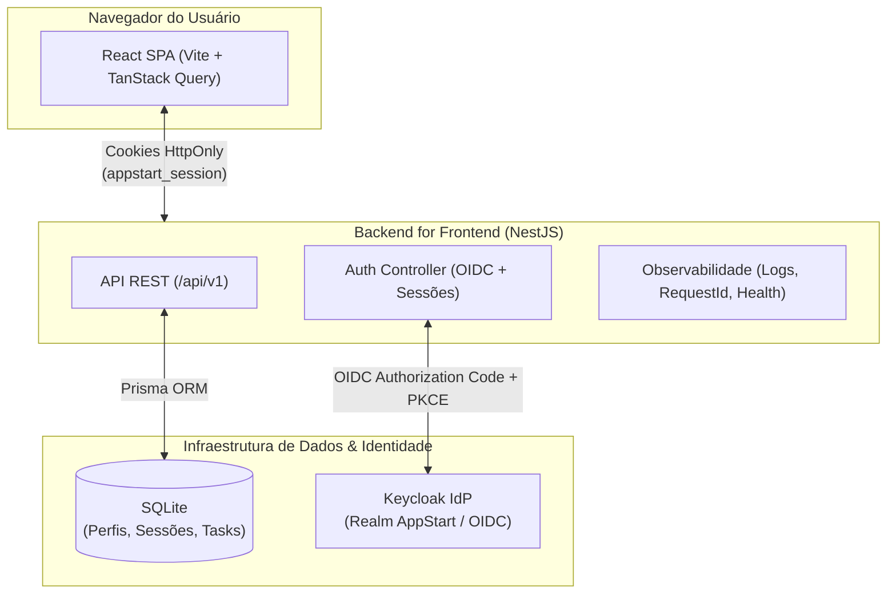
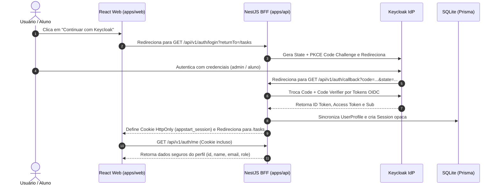
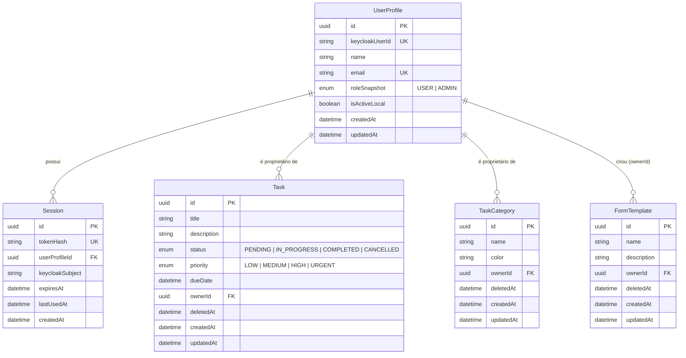

# Visão Geral da Arquitetura do AppStart

O **AppStart** é um template pedagógico de arquitetura de software full stack projetado para ensinar padrões profissionais de engenharia de software, segurança de identidade (OIDC/Keycloak), tipagem ponta a ponta e separação de responsabilidades.

---

## 🏗️ 1. Topologia do Sistema

---

## 🔐 2. Fluxo de Autenticação OIDC e Sessão BFF

---

## 🗄️ 3. Modelo de Dados Relacional (ER)

> `FormTemplate` (tabela `form_templates`) é o cadastro base do Construtor de Fichas: apenas metadados do modelo, atrelado ao criador. Campos e estrutura da ficha virão em etapas posteriores. Ver [ADR-007](decisions/ADR-007-form-builder-subordinate-to-prontuario.md).

---

## 📋 4. Catálogo Canônico de Endpoints da API

| Método | Endpoint | Proteção | Papel Mínimo | Descrição |
| :--- | :--- | :--- | :--- | :--- |
| `GET` | `/health/live` | Público | - | Verificação de processo vivo (*liveness*) |
| `GET` | `/health/ready` | Público | - | Verificação de prontidão com banco (*readiness*) |
| `GET` | `/api/v1/auth/login` | Público | - | Inicia fluxo OIDC no Keycloak |
| `GET` | `/api/v1/auth/callback` | Público | - | Processa retorno do Keycloak e emite sessão |
| `GET` | `/api/v1/auth/me` | Sessão | `USER` | Consulta perfil e sessão ativa do usuário |
| `GET` | `/api/v1/auth/account` | Sessão | `USER` | Redireciona para o Console de Conta do Keycloak |
| `POST` | `/api/v1/auth/logout` | Sessão + CSRF | `USER` | Revoga a sessão local ativa |
| `POST` | `/api/v1/auth/logout-all` | Sessão + CSRF | `USER` | Revoga todas as sessões do usuário |
| `GET` | `/api/v1/admin/access-check` | Sessão | `ADMIN` | Verificação de privilégios administrativos |
| `GET` | `/api/v1/users` | Sessão | `ADMIN` | Listagem paginada e filtrada de usuários |
| `POST` | `/api/v1/users` | Sessão + CSRF | `ADMIN` | Provisiona novo usuário no Keycloak |
| `GET` | `/api/v1/users/:id` | Sessão | `ADMIN` | Detalhes de um usuário específico |
| `PATCH` | `/api/v1/users/:id` | Sessão + CSRF | `ADMIN` | Atualiza dados de um usuário |
| `PATCH` | `/api/v1/users/:id/status` | Sessão + CSRF | `ADMIN` | Ativa ou desativa um usuário |
| `PATCH` | `/api/v1/users/me` | Sessão + CSRF | `USER` | Autoatendimento de perfil (nome) |
| `GET` | `/api/v1/tasks` | Sessão | `USER` | Lista tarefas com paginação, busca e filtros |
| `POST` | `/api/v1/tasks` | Sessão + CSRF | `USER` | Cria nova tarefa com ownership |
| `GET` | `/api/v1/tasks/:id` | Sessão | `USER` | Detalhes da tarefa (owner ou admin) |
| `PUT` | `/api/v1/tasks/:id` | Sessão + CSRF | `USER` | Atualiza tarefa respeitando regras de transição |
| `DELETE`| `/api/v1/tasks/:id` | Sessão + CSRF | `USER` | Remoção lógica (*soft delete*) da tarefa |
| `GET` | `/api/v1/categories` | Sessão | `USER` | Lista categorias de tarefas (paginado, busca por nome) |
| `POST` | `/api/v1/categories` | Sessão + CSRF | `USER` | Cria categoria |
| `GET` | `/api/v1/categories/:id` | Sessão | `USER` | Detalhes da categoria (owner ou admin) |
| `PUT` | `/api/v1/categories/:id` | Sessão + CSRF | `USER` | Atualiza categoria |
| `DELETE`| `/api/v1/categories/:id` | Sessão + CSRF | `USER` | Remoção lógica da categoria |
| `GET` | `/api/v1/form-access/me` | Sessão | `USER` | Perfis e permissões do Construtor para o usuário atual (**mock**) |
| `GET` | `/api/v1/prontuario/status` | Sessão | `USER` | Estado da integração com o prontuário (**mock**) |
| `GET` | `/api/v1/prontuario/pacientes/:pacienteId` | Sessão | Perm. `PRONTUARIO_READ` + prontuário disponível | Resumo de paciente no prontuário (**mock**) |
| `GET` | `/api/v1/form-templates` | Sessão | Perm. `TEMPLATE_READ_OWN`/`READ_ALL` + prontuário disponível | Lista modelos de ficha (Configurador: os seus; Supervisão: todos) |
| `POST` | `/api/v1/form-templates` | Sessão + CSRF | Perm. `TEMPLATE_CREATE` + prontuário disponível | Cria modelo de ficha (nome, descrição) com ownership |
| `GET` | `/api/v1/form-templates/:id` | Sessão | Perm. `TEMPLATE_READ_OWN`/`READ_ALL` + prontuário disponível | Detalhes do modelo (dono ou Supervisão) |
| `PUT` | `/api/v1/form-templates/:id` | Sessão + CSRF | Perm. `TEMPLATE_UPDATE` + prontuário disponível | Atualiza nome/descrição (dono ou `ADMIN`) |
| `DELETE`| `/api/v1/form-templates/:id` | Sessão + CSRF | Perm. `TEMPLATE_DELETE` + prontuário disponível | Remoção lógica (*soft delete*) do modelo |
| `POST` | `/api/v1/form-templates/:id/transitions` | Sessão + CSRF | Perm. `TEMPLATE_UPDATE`/`TEMPLATE_REVIEW` + prontuário disponível | Muda o status do modelo (ciclo Rascunho → Em revisão → Aprovado → Publicado ⇄ Suspenso → Inativo) |
| `POST` | `/api/v1/form-templates/:id/derive` | Sessão + CSRF | Perm. `TEMPLATE_CREATE` + prontuário disponível | Deriva novo modelo (Rascunho v1.0.0) copiando cadastro e estrutura |
| `GET` | `/api/v1/form-templates/:templateId/structure` | Sessão | Perm. `TEMPLATE_READ_OWN`/`READ_ALL` + prontuário disponível | Árvore da ficha: seções, grupos e campos (`FormSection`, `FormGroup`, `FormField`) |
| `POST` | `/api/v1/form-templates/:templateId/sections` | Sessão + CSRF | Perm. `TEMPLATE_UPDATE` + prontuário disponível | Adiciona seção (dono, modelo em Rascunho) |
| `PUT` | `/api/v1/form-templates/:templateId/sections/reorder` | Sessão + CSRF | Perm. `TEMPLATE_UPDATE` + prontuário disponível | Reordena seções |
| `PUT` | `/api/v1/form-templates/:templateId/sections/:sectionId` | Sessão + CSRF | Perm. `TEMPLATE_UPDATE` + prontuário disponível | Edita seção |
| `DELETE` | `/api/v1/form-templates/:templateId/sections/:sectionId` | Sessão + CSRF | Perm. `TEMPLATE_UPDATE` + prontuário disponível | Exclui seção com grupos e campos |
| `POST` | `/api/v1/form-templates/:templateId/sections/:sectionId/groups` | Sessão + CSRF | Perm. `TEMPLATE_UPDATE` + prontuário disponível | Adiciona grupo (subseção) |
| `PUT` | `/api/v1/form-templates/:templateId/sections/:sectionId/groups/reorder` | Sessão + CSRF | Perm. `TEMPLATE_UPDATE` + prontuário disponível | Reordena grupos da seção |
| `PUT` | `/api/v1/form-templates/:templateId/groups/:groupId` | Sessão + CSRF | Perm. `TEMPLATE_UPDATE` + prontuário disponível | Edita grupo |
| `DELETE` | `/api/v1/form-templates/:templateId/groups/:groupId` | Sessão + CSRF | Perm. `TEMPLATE_UPDATE` + prontuário disponível | Exclui grupo com campos |
| `POST` | `/api/v1/form-templates/:templateId/fields` | Sessão + CSRF | Perm. `TEMPLATE_UPDATE` + prontuário disponível | Adiciona campo (tipo, obrigatoriedade, condições, cálculo) |
| `PUT` | `/api/v1/form-templates/:templateId/fields/reorder` | Sessão + CSRF | Perm. `TEMPLATE_UPDATE` + prontuário disponível | Reordena campos de uma seção/grupo |
| `PUT` | `/api/v1/form-templates/:templateId/fields/:fieldId` | Sessão + CSRF | Perm. `TEMPLATE_UPDATE` + prontuário disponível | Configura/move campo |
| `DELETE` | `/api/v1/form-templates/:templateId/fields/:fieldId` | Sessão + CSRF | Perm. `TEMPLATE_UPDATE` + prontuário disponível | Exclui campo (se nenhum outro depender dele) |

### 4.1 Construtor de Fichas: entidades e microfrontend

- Entidades: `FormTemplate` (cadastro do modelo), `FormTemplateVersion` (histórico de versões), `FormSection` (seções), `FormGroup` (grupos/subseções) e `FormField` (campos com regras em JSON).
- Microfrontend: o front é o remote `recordsMfe` do shell Clínica Digital (porta 5178, `./App`); dentro do shell as chamadas usam `/api/v1/records/...` e a API valida a sessão do shell (`AUTH_MODE=shell`). Ver README.

### 4.2 Construtor de Fichas: perfis (RBAC mock) e regra de ouro

| Perfil | Permissões | Observação |
| :--- | :--- | :--- |
| `CONFIGURADOR` | `TEMPLATE_CREATE`, `TEMPLATE_READ_OWN`, `TEMPLATE_UPDATE`, `TEMPLATE_DELETE`, `PRONTUARIO_READ` | Cria e mantém os próprios modelos |
| `PREENCHIMENTO` | `PRONTUARIO_READ` | Ainda sem acesso a modelos (não há conceito de modelo publicado) |
| `SUPERVISAO` | `TEMPLATE_READ_ALL`, `TEMPLATE_REVIEW`, `PRONTUARIO_READ` | Lê todos os modelos e governa o ciclo de vida (aprovar, publicar, suspender) |

- **Mock:** perfis derivados do `UserRole` (`ADMIN` → Configurador + Supervisão; `USER` → Preenchimento). Persistência e atribuição reais de perfis ainda não existem; basta trocar `MockFormAccessService` em `FormAccessModule`.
- **Regra de ouro:** o construtor é subordinado ao prontuário. Rotas do construtor passam pelo `ProntuarioSubordinationGuard` (503 se o prontuário estiver indisponível) e o prontuário nunca depende do construtor. O `MockProntuarioGateway` será substituído pela integração real em `ProntuarioModule`.

---

## ⚙️ 5. Diferenças entre Desenvolvimento e Produção

| Aspecto | Ambiente de Desenvolvimento (`development`) | Ambiente de Produção (`production`) |
| :--- | :--- | :--- |
| **Formato de Logs** | Colorido e legível no terminal (`NestLogger`) | JSON Estruturado com `requestId`, `timestamp` e `level` |
| **Segredos e Credenciais** | Valores padrão documentados no `.env.example` | Variáveis injetadas via Vault, KMS ou CI/CD secrets |
| **Cookies de Sessão** | `Secure: false` (para suporte a `http://localhost`) | `Secure: true` (estritamente sobre conexões HTTPS) |
| **Swagger UI** | Habilitado em `/api/docs` | Desabilitado ou protegido sob firewall corporativo |
| **Banco de Dados** | Arquivo SQLite local com seed (`npm run db:seed`) | SQLite em volume persistente com backup do arquivo e migrations via pipeline (ou banco gerenciado, se houver múltiplas instâncias) |
| **Keycloak** | Instância local Docker na porta `8080` com realm importado | IdP corporativo de alta disponibilidade com TLS |
